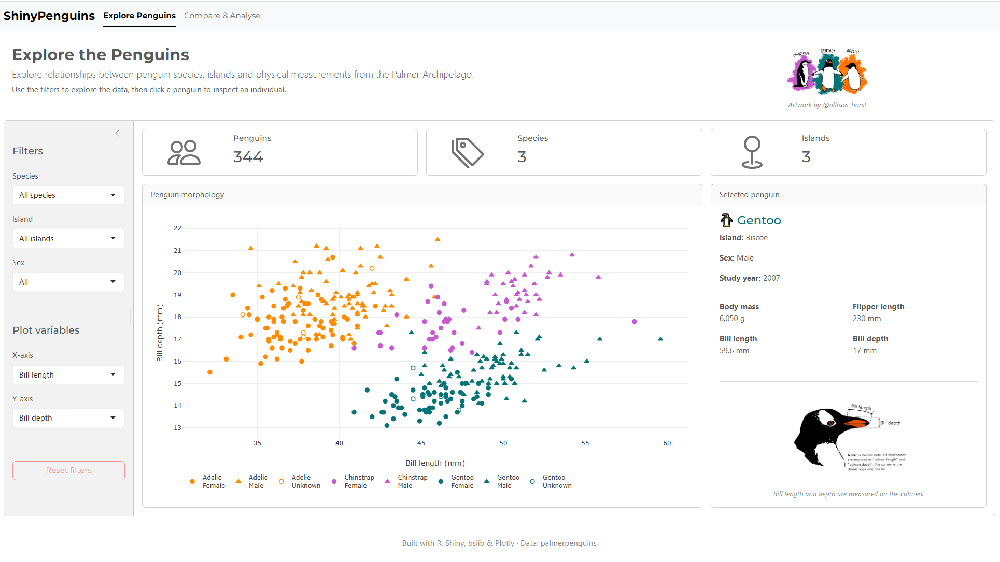

# ShinyPenguins

An interactive R Shiny dashboard for exploring the Palmer Penguins dataset. Filter by species, island and sex, compare measurements across species, and investigate relationships between physical traits.

 

**Live app:** https://changbio.shinyapps.io/Shiny_Penguin/

## Features

### Explore Penguins
- Filter by **species**, **island** and **sex**
- Choose any two measurements for the X and Y axes
- Interactive scatter plot (colour = species, shape = sex, hollow circle = unknown sex)
- Click a penguin to see its details: species, island, sex, study year and measurements

### Compare & Analyse
- Box plot of any measurement by species, with a summary table (n, mean, median, SD)
- Scatter plot of any two measurements, coloured by species
- Correlation by species, plus an overall value for all penguins

## Data

The data comes from the [`palmerpenguins`](https://allisonhorst.github.io/palmerpenguins/) R package: size measurements for 344 penguins of three species (Adelie, Chinstrap, Gentoo) observed on three islands (Biscoe, Dream, Torgersen) in the Palmer Archipelago, Antarctica, from 2007 to 2009.

Measurements used: bill length, bill depth, flipper length and body mass. A few penguins have missing values (for example, no recorded sex).

## Built with

- [R](https://www.r-project.org/) and [Shiny](https://shiny.posit.co/)
- [bslib](https://rstudio.github.io/bslib/) for the layout and theme
- [plotly](https://plotly.com/r/) for interactive plots
- [dplyr](https://dplyr.tidyverse.org/) for data manipulation
- [bsicons](https://github.com/rstudio/bsicons) for icons

## Credits

- Data: Horst AM, Hill AP, Gorman KB (2020). *palmerpenguins: Palmer Archipelago (Antarctica) penguin data.* R package.
- Original penguin data: Dr. Kristen Gorman and the [Palmer Station LTER](https://pal.lternet.edu/).
- Artwork: [@allison_horst](https://twitter.com/allison_horst)

## License

MIT
